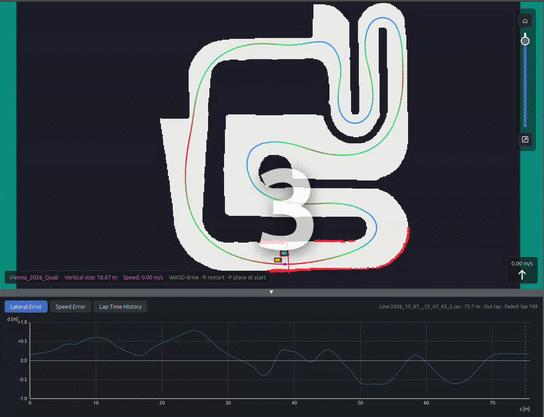
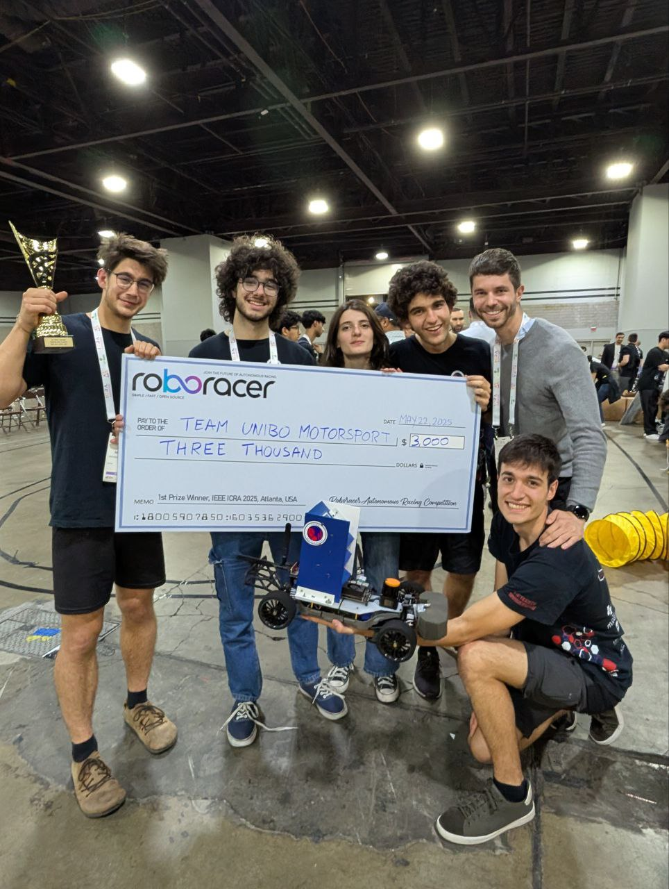
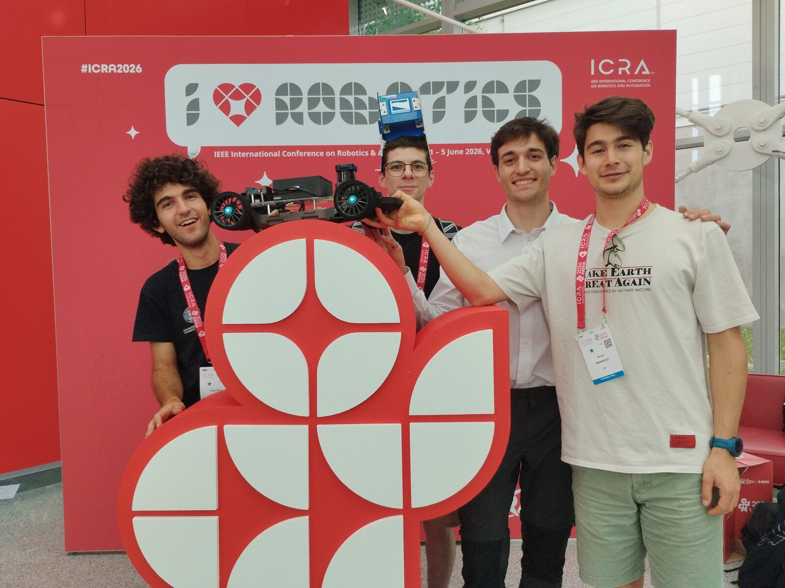
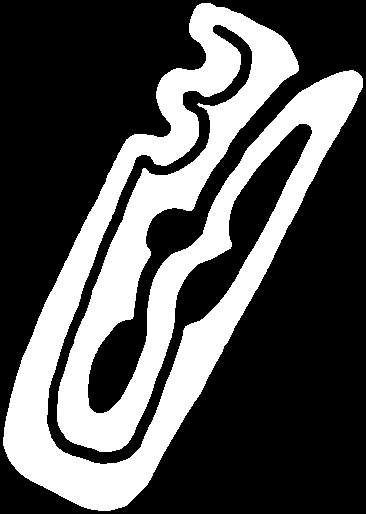
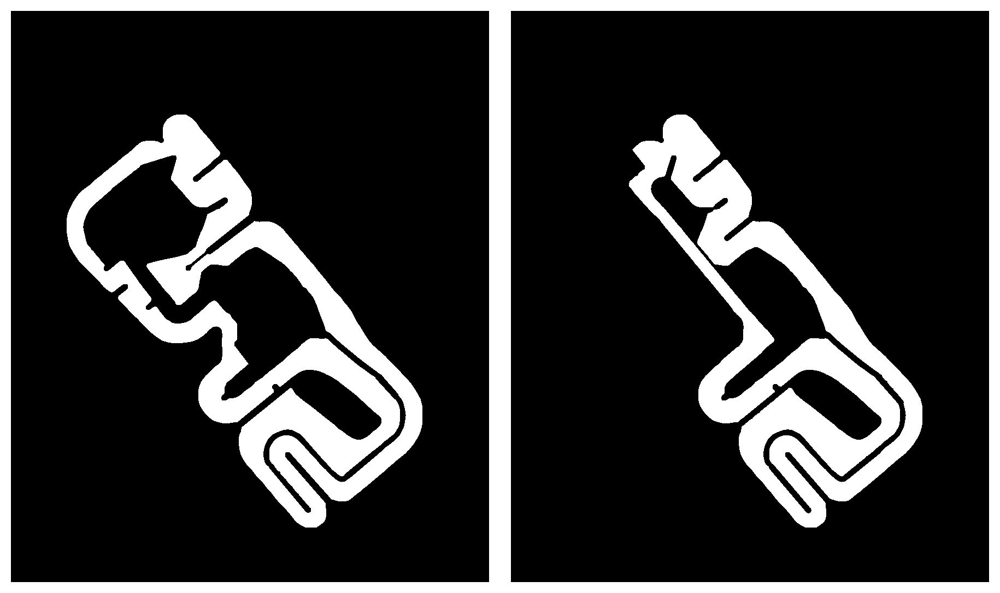
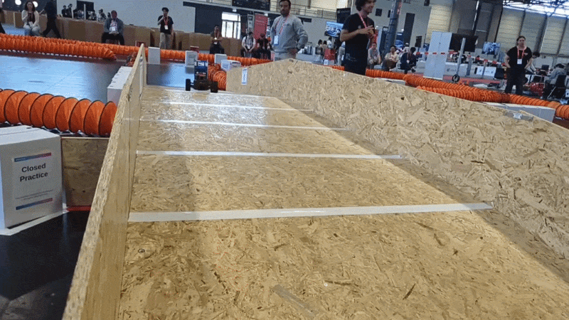
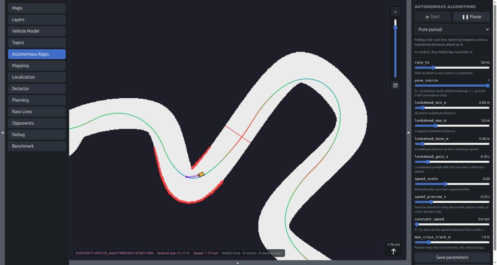
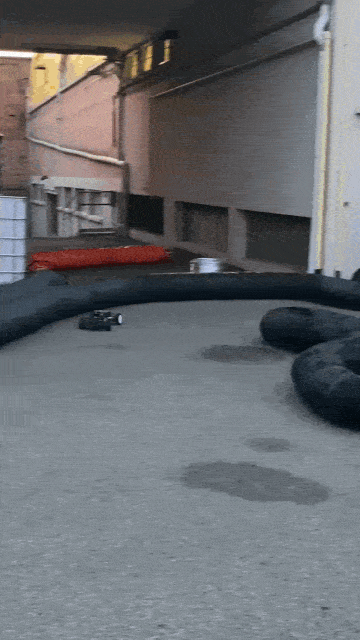

# AuRoRus: our RoboRacer stack, open-sourced and written in Rust

What if I told you that the following is just a few terminal commands away from you?



*Our two race algorithms, Frenet overtaking and MPC, racing each other in simulation on the ICRA 2026 Vienna qualifying track.*

No containers, no system dependencies, no workspace juggling: one `cargo build` and you're done. [Try it](https://github.com/Noce99/AuRoRus):

```sh
# install Rust, then load it into the current shell:
curl --proto '=https' --tlsv1.2 -sSf https://sh.rustup.rs | sh
. "$HOME/.cargo/env"
# get the code and build it:
git clone https://github.com/Noce99/AuRoRus && cd AuRoRus
cargo build --release
./target/release/web_gui
# then open http://localhost:1999
```

My name is Enrico Mannocci. I'm a third-year PhD student, and I have been the leader of the University of Bologna 1:10 Scale Driverless division since 2024. After winning the RoboRacer competition at ICRA 2025 in Atlanta, and taking second and third place in the Master Cup with our two cars at ICRA 2026 in Vienna, we are ready to open-source our race stack for everyone.
In this post we present AuRoRus: an independent autonomous RoboRacer stack whose every node is written in Rust (ROS 2-free).

## Why we built AuRoRus

Too many beginner students were quitting our autonomous driving group early, after struggling for hours to get the whole ROS 2 pipeline working on their laptops. They joined to make a car race, and they left before writing a single line of racing code. We wanted a stack that a new member can build with one command and drive in simulation within the first afternoon, so that the hours go into the algorithms and not into the setup.

## Why not ROS 2?

ROS 2 is a great tool, but it's too generic for our use case. That's fine: we don't expect anything else from software called Robot Operating System. But by using it you accept a comfort zone that you pay for with efficiency and with tons of features you don't really use (like DDS discovery traffic, which is a common cause of connection drops over the congested Wi-Fi of a race area). That said, we really like the ROS 2 topic-node paradigm, and we ported it into AuRoRus.

## Why Rust?

Rust is a really pedantic, slow-to-write language that gets you very close to the old-fashioned programmer's dream of "if it compiles, it works". It also executes extremely fast, totally [comparable](https://programming-language-benchmarks.vercel.app/c-vs-rust) with the evergreen C, but with much easier-to-understand compiler errors (and readable runtime panics too). It has a very mature package manager, **cargo**, that lets you compile other people's code with very little effort. Everything is amazing, but the "really pedantic, slow-to-write language" part is still there... or maybe not? What if an efficient Rust backbone that shares information between nodes, lets you see everything live and lets you debug in detail was already there, and you just needed to write the important code? That's what AuRoRus is.

## Why a web GUI? Isn't it too slow?

It's the best way to see what is really happening on our cars, and we did our best to keep it as resource-light as possible. The page is plain HTML, CSS and JavaScript, with no framework and no build step, and it is compiled into the binary, so there is nothing to deploy. It polls the car at a rate you choose, from 1 to 100 Hz (30 Hz by default), so you can turn it down on a slow connection. It's also completely removable: it's just a node like all the others, and you can turn it off and run the whole stack without it.

## Why now?

We started thinking about porting our ROS 2 repo to Rust two years ago, but we had the ideas and no time to implement them. AI-assisted development let us build this repo over the summer. To be clear about who did what: the racing algorithms were designed by our team and raced on our ROS 2 stack first, and AI helped us port them to Rust and write the code around them, such as the node backbone, the GUI, the drivers and the documentation. We did our best to keep the code clean, documented, well written and, most importantly, easy for humans to extend. LLMs are good at writing boring code, but we believe the really important parts of autonomous racing need to be written by humans to be effective.

## The team behind it

AuRoRus is ported from the work of the whole UniBo driverless team. [Samuele Crimi](https://github.com/SamueleCrimi) and [Edoardo Fusa](https://github.com/Scheggetta) wrote the first implementations of the Frenet overtaking, the algorithm that won Atlanta, and of the Path Follower. [Alberto De Nardis](https://github.com/AlbYoda) built the opponent detector and is now working on a faster, Acados-based MPC. [Francesco Ognibene](https://github.com/FelixFrog) built the map switch that let us drive the bridge track in Vienna, and is now working on a new MPPI controller. [Enrico Mannocci](https://github.com/Noce99) (me) leads the team, wrote the MPC (Acados-free) and the race-line planning, worked on making the whole stack fast to fine-tune during a race, and ported everything to Rust. Many thanks also to [Simone Zama](https://github.com/TorioCrema), [Federico Calzoni](https://github.com/FedericoCalzoni), [Beatrice Bottari](https://github.com/beatricebottari), [Luca Tedeschini](https://github.com/LucaTedeschini), [Nicolas Ivan Cridlig](https://github.com/ncridlig) and [Stefano Colamonaco](https://github.com/StefanoColamonaco), and to [Gianluca Galletti](https://github.com/gerkone), who founded the team.



*Atlanta, ICRA 2025: first place in the RoboRacer competition.*



*Vienna, ICRA 2026: second and third place in the Master Cup.*

## What can I do with AuRoRus?

You can simulate, or run on real hardware, every part of a RoboRacer race or test session. More precisely, you can:
1) Calibrate your hardware
2) Map a new track
3) Localize the vehicle on a previously mapped track
4) Plan a race line on a map
5) Run reactive control algorithms
6) Run path-following algorithms with overtaking strategies
7) Benchmark different control algorithms and compare them in detail
8) Record debug sessions and replay them step by step
9) Record mapping sessions to fine-tune the mapping
10) Run your whole stack with minimal laptop-car communication in RF-congested environments such as race venues

## What's in the repo

### The real race tracks

AuRoRus ships with the maps of the tracks we actually raced on, so you can train on them in simulation:

| Map | Track |
|---|---|
| `Atlanta_2025` | ICRA 2025, Atlanta |
| `Vienna_2026_Quali` | ICRA 2026, Vienna: the qualifying track |
| `Vienna_2026_Final_Ground` | ICRA 2026, Vienna: the final track, at ground level |
| `Vienna_2026_Final_Bridge` | ICRA 2026, Vienna: the same final track, on the bridge level |

The Vienna final track crossed over itself on a bridge, so it comes as two maps of the same area, one per level.



*The ICRA 2025 Atlanta track.*



*The ICRA 2026 Vienna final track: the ground level (left) and the bridge level (right).*



*Our car jumping on the bridge of the Vienna final track.*

### Tutorials: from an empty file to a driving car

The repo includes [step-by-step tutorials](https://github.com/Noce99/AuRoRus/tree/master/tutorials) that write an autonomous driving algorithm from an empty file: first a gap follower, which drives using only the LiDAR, then a pure pursuit, which follows a race line. They explain the theory, the code and how the algorithm talks to the rest of the stack, and no Rust experience is assumed. A new algorithm is just a new file in `src/autonomous_control/`: the same `cargo build --release` finds it, and it shows up in the GUI with its parameters tunable live.



*The pure pursuit, the algorithm of the second tutorial, driving in simulation with its parameters tuned live from the GUI.*

## Supported hardware

AuRoRus drives the real car through these drivers:
- **Motor controller:** VESC 6 MkV over USB serial, which also provides the IMU
- **LiDAR:** Hokuyo UTM-30LX-EW, Hokuyo UST-10LX or any Hokuyo speaking SCIP 2.0 over Ethernet
- **Gamepad:** tested with wireless dongle gamepads

The onboard computer just needs to run Linux. Every driver can be tested on its own with the `probe` tool, and `car_calibration` guides you through calibrating a new car. If your car uses different hardware, a new driver is just another node.



## Is AuRoRus for beginners?

Absolutely, yes. We don't know an easier way into the RoboRacer world: one command to build, a simulator with the real race tracks, and tutorials that take you from an empty file to a car driving a lap.

## Conclusion

Can't wait to see you in Seoul at ICRA 2027. Well, we hope so: it would mean we found the money to bring our team to the RoboRacer race again. If you'd like to help us get to Seoul, reach out at [enrico.mannocci3@unibo.it](mailto:enrico.mannocci3@unibo.it)! Good luck with the new season, enjoy [AuRoRus](https://github.com/Noce99/AuRoRus) (dual-licensed MIT/Apache-2.0), and if you like the project, don't hesitate to open a pull request with your algorithms.
